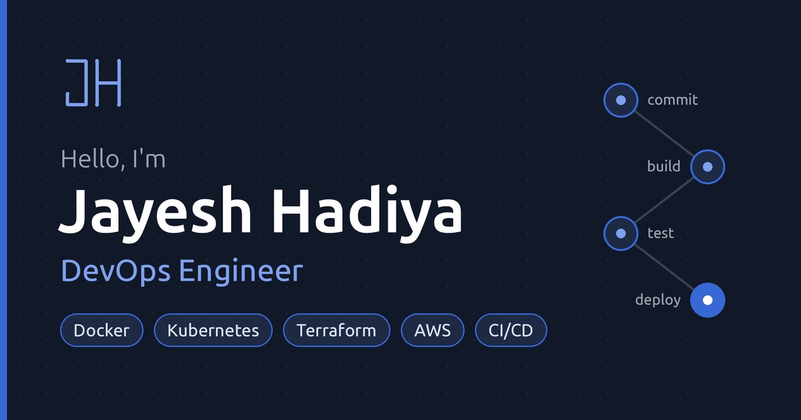

# Jayesh Hadiya — Portfolio

Personal site and blog of Jayesh Hadiya, DevOps engineer from India.



## Stack
- **Framework**: [Angular](https://angular.dev/) with server-side rendering and prerendering
- **Styling**: [Tailwind CSS](https://tailwindcss.com/)
- **CI**: GitHub Actions builds and prerenders the site on every push (`.github/workflows/ci.yml`)

## Features 📋
⚡️ Light and dark mode, toolbar colour theme selector\
⚡️ Blog written in Markdown (`src/assets/json/blogs.json`) with table of contents, heading links, syntax highlighting, copy-code buttons, reading progress and previous/next posts\
⚡️ RSS feed, sitemap and robots.txt generated at build time\
⚡️ Contact form (Web3Forms), share buttons, Trakt "watching" widget, Umami analytics

## Sections 📚
✔️ Home (intro, expertise, languages and tools, current work)\
✔️ About\
✔️ Experience\
✔️ Blog\
✔️ Uses

## Running Locally

This application requires Node.js 20 (18.13+ also works).

```bash
npm install
cp src/environments/environment.ts.bak src/environments/environment.ts
cp src/environments/environment.development.ts.bak src/environments/environment.development.ts
npm start
```

Then open http://localhost:4200.

The copied environment files are git-ignored, so your keys stay on your machine. Fill them in:

- `url`: your live site address, no trailing slash (used for canonical links, social previews, `robots.txt`, `sitemap.xml` and `rss.xml`)
- `production`: `true` in `environment.ts` so analytics load on the live site
- `web3formsKey`: free key from [web3forms.com](https://web3forms.com) for the contact form; without it the form opens the visitor's email app
- `umamiWebsiteId`, `traktTv`, `themoviedb`: optional

## Editing Content

| What | Where |
|---|---|
| Name, bio, greetings, email, resume link | `src/app/data/profile.data.ts` |
| Work experience | `src/app/data/experience.data.ts` |
| Expertise areas | `src/app/data/expertise-area.data.ts` |
| "In my work" tools | `src/app/data/in-work.data.ts` |
| Languages and tools | `src/assets/json/language-tools.json` |
| Social links | `src/app/data/social-link.data.ts` |
| About page text and contact info | `src/app/pages/about/about.page.ts` |
| Blog posts | `src/assets/json/blogs.json` |
| Social preview image (1200×630) | `src/assets/image/meta-image.jpg` |

**Resume:** the Resume button is hidden while `resumeLink` is empty. To show it, put your PDF in `src/` (e.g. `src/cv.pdf`), add `"src/cv.pdf"` to both `assets` lists in `angular.json`, and set `resumeLink: 'cv.pdf'`.

**New blog post:** add an entry to `blogs.json` with a unique `slug`, `publishedAt` and `updatedAt`. The page, sitemap, RSS feed and prerender route are created automatically on the next build.

## Building

```bash
npm run prerender   # static HTML for every page and blog post in dist/client/browser
```

`scripts/generate-seo-files.mjs` runs before every build. It reads the nav links and blog posts and writes `routesFile.txt` (pages to prerender) plus the sitemap, RSS feed and robots.txt.

## Deploying

The prerendered output is plain static files, so any static host works.

The environment files are git-ignored, so before every build `scripts/setup-env.mjs` creates any missing ones from the `.bak` templates, filling in these environment variables from your host:

| Variable | Value |
|---|---|
| `SITE_URL` | Your live address, e.g. `https://jayeshhadiya.vercel.app` (on Vercel this defaults to the project's production domain) |
| `WEB3FORMS_KEY` | Contact form key from [web3forms.com](https://web3forms.com) |
| `UMAMI_WEBSITE_ID` | Optional analytics id |

**Vercel:** import the repo; `vercel.json` already sets the build command (`npm run prerender`), the output directory (`dist/client/browser`) and the fallback for client-side routes. Add the variables above under Project → Settings → Environment Variables.

**Cloudflare Pages:** build command `npm run prerender`, output directory `dist/client/browser`, and the same environment variables.
